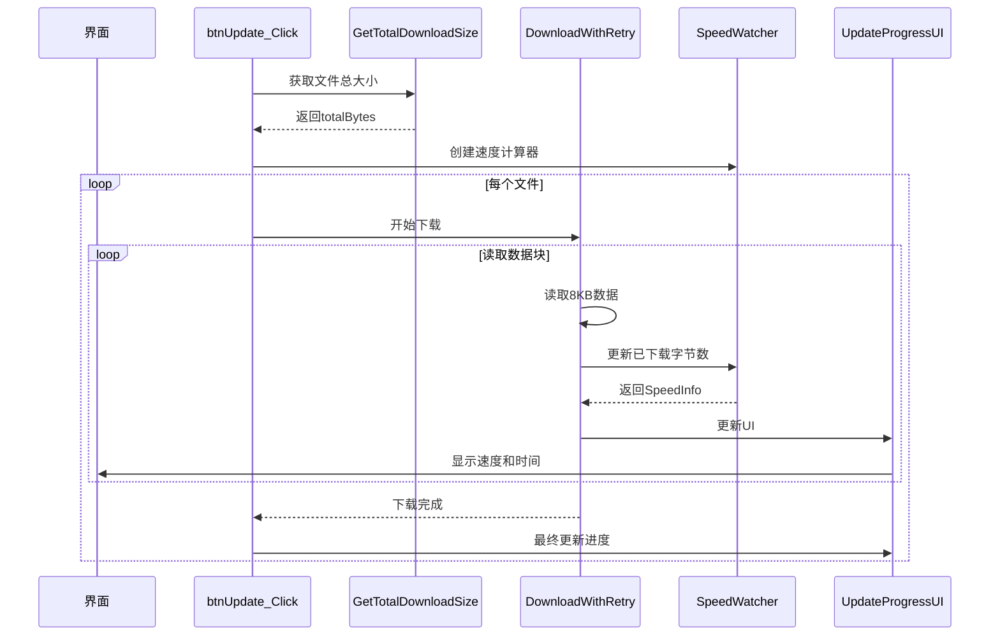

# 下载速度和剩余时间显示功能说明

## 📅 修改日期
2026-10-14

---

## ✨ 新增功能

### 界面显示
下载更新时会实时显示：

| 控件 | 显示内容 | 示例 |
|------|----------|------|
| **进度条** | 下载百分比 | 75% |
| **百分比标签** | 百分比 + 已下载/总大小 | 75% (750 MB/1 GB) |
| **下载速度** | 实时下载速度 | 5.2 MB/s |
| **剩余时间** | 预估剩余时间 | 1分30秒 |

---

## 🔧 技术实现

### 1. 获取文件总大小
在开始下载前，通过 HTTP HEAD 请求获取所有需要下载文件的总大小：

```csharp
private async Task<long> GetTotalDownloadSizeAsync(List<FileItem> files, CancellationToken token)
{
    long totalSize = 0;
    foreach (var file in files)
    {
        var request = new HttpRequestMessage(HttpMethod.Head, file.url);
        var response = await _httpClient.SendAsync(request, token);
        
        if (response.IsSuccessStatusCode && response.Content.Headers.ContentLength.HasValue)
        {
            totalSize += response.Content.Headers.ContentLength.Value;
        }
    }
    return totalSize;
}
```

### 2. 实时速度计算
使用 `SpeedWatcher` 辅助类计算下载速度：

```csharp
private class SpeedWatcher
{
    private readonly Stopwatch _stopwatch;
    private readonly Queue<(long ticks, long bytes)> _history;
    
    public SpeedInfo Update(long currentBytes, long totalBytes)
    {
        // 记录采样历史
        // 基于最近10个采样点计算平均速度
        // 估算剩余时间 = 剩余字节 / 当前速度
    }
}
```

**计算原理**：
- 使用滑动窗口（最近10个采样点）
- 计算平均速度，避免速度波动
- 剩余时间 = 剩余字节 ÷ 当前速度

### 3. 进度回调
下载方法支持进度回调：

```csharp
private async Task<bool> DownloadWithRetryAsync(
    FileItem fileItem, 
    string localFilePath, 
    CancellationToken token, 
    int maxRetries = 3, 
    Action<long, long> progressCallback = null)  // 进度回调
{
    // ...
    while ((readLen = await stream.ReadAsync(buffer, 0, buffer.Length, token)) > 0)
    {
        await fs.WriteAsync(buffer, 0, readLen, token);
        bytesRead += readLen;
        
        // 每100ms更新一次进度（避免UI卡顿）
        if (now - lastUpdateTime >= updateInterval)
        {
            progressCallback?.Invoke(bytesRead, totalBytes);
        }
    }
}
```

**优化措施**：
- 进度更新频率限制为每100ms一次
- 避免高频更新导致UI卡顿

---

## 📊 格式化函数

### 文件大小格式化
```csharp
FormatSize(1024)        // "1 KB"
FormatSize(1048576)     // "1 MB"
FormatSize(1572864)     // "1.5 MB"
```

### 下载速度格式化
```csharp
FormatSpeed(1024)       // "1 KB/s"
FormatSpeed(5242880)    // "5 MB/s"
```

### 剩余时间格式化
```csharp
FormatTime(TimeSpan.FromSeconds(30))    // "30秒"
FormatTime(TimeSpan.FromMinutes(2))      // "2分0秒"
FormatTime(TimeSpan.FromHours(1))        // "1时0分"
```

---

## 🎯 使用流程



---

## 🖼️ 界面效果

```
┌──────────────────────────────────────────────────────────┐
│  [=============                ] 75% (750 MB/1 GB)      │
│                                                          │
│  下载速度：5.2 MB/s          剩余时间：1分30秒          │
│                                                          │
│  日志：                                                   │
│  10:30:00 总下载大小：1 GB                               │
│  10:30:05 正在下载：Game.exe                             │
│  10:30:35 完成：Game.exe                                 │
│  10:30:36 正在下载：Data/resources.assets                │
│  ...                                                     │
└──────────────────────────────────────────────────────────┘
```

---

## 📝 修改文件

| 文件 | 修改内容 |
|------|----------|
| `Updater\Form1.cs` | 添加速度计算、进度显示、格式化函数 |

---

## ⚠️ 注意事项

1. **服务器支持**: HTTP服务器必须支持HEAD请求才能获取文件大小
2. **频率限制**: 进度更新频率限制为100ms，避免UI卡顿
3. **无法获取大小时**: 如果无法获取总大小，会退回到按文件数量显示进度
4. **速度准确性**: 使用滑动窗口平均值，速度更稳定

---

**文档版本**: 1.0  
**创建日期**: 2026-10-14