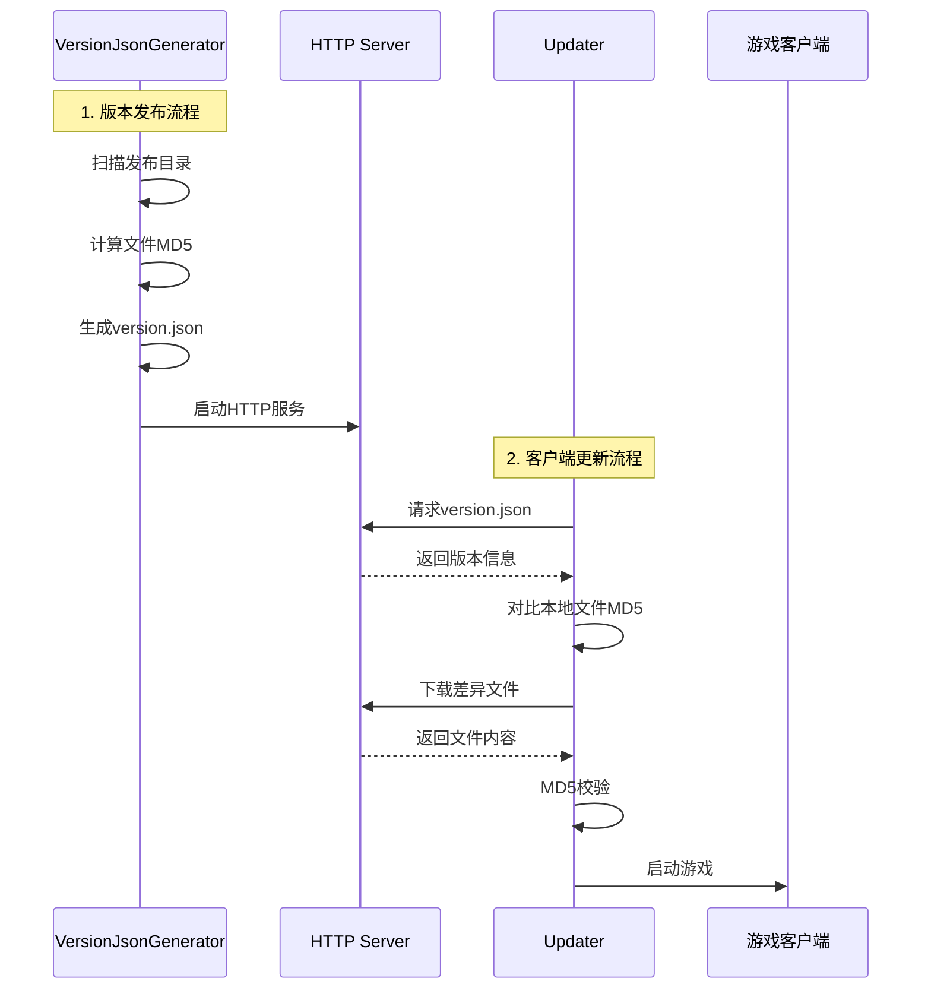
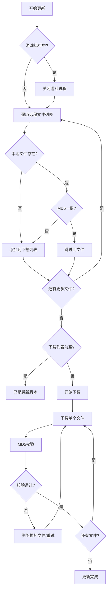
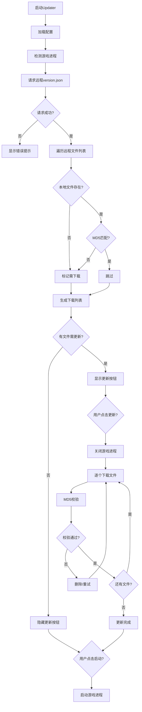
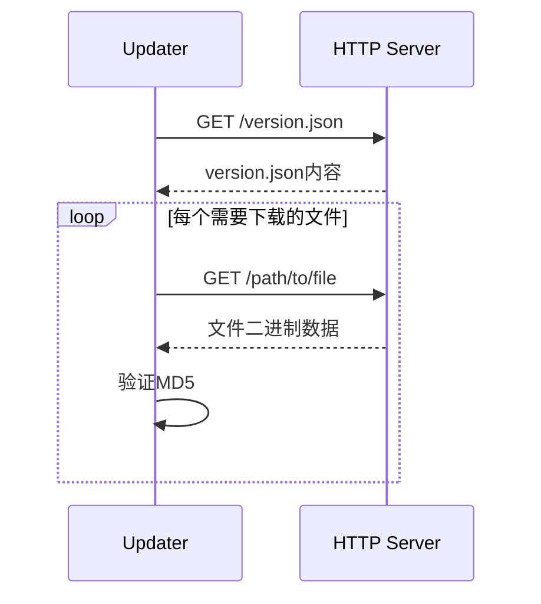

# VersionJsonGenerator 项目开发手册

## 📋 目录

1. [项目概述](#1-项目概述)
2. [系统架构](#2-系统架构)
3. [项目结构](#3-项目结构)
4. [核心模块详解](#4-核心模块详解)
5. [数据结构](#5-数据结构)
6. [工作流程](#6-工作流程)
7. [配置说明](#7-配置说明)
8. [部署指南](#8-部署指南)
9. [扩展开发](#9-扩展开发)

---

## 1. 项目概述

### 1.1 项目简介

**VersionJsonGenerator** 是一套完整的软件版本管理与自动更新解决方案，包含两个核心组件：

| 组件 | 角色 | 功能 |
|------|------|------|
| **VersionJsonGenerator** | 服务端工具 | 版本信息生成、HTTP文件服务器 |
| **Updater** | 客户端工具 | 版本检测、文件下载、自动更新 |

### 1.2 技术栈

- **框架**: .NET Framework 4.8
- **UI框架**: Windows Forms
- **JSON处理**: Newtonsoft.Json 13.0.4
- **HTTP服务**: HttpListener（内置）
- **加密算法**: MD5

### 1.3 应用场景

- Unity游戏客户端自动更新
- 软件版本管理
- 增量更新（仅下载变更文件）
- 局域网内部署测试

---

## 2. 系统架构

### 2.1 整体架构图

```
┌─────────────────────────────────────────────────────────────────┐
│                        系统整体架构                               │
├─────────────────────────────────────────────────────────────────┤
│                                                                 │
│  ┌──────────────────────┐         ┌──────────────────────┐     │
│  │  VersionJsonGenerator │         │       Updater        │     │
│  │    (服务端工具)        │         │    (客户端工具)       │     │
│  ├──────────────────────┤         ├──────────────────────┤     │
│  │ • 文件扫描            │◄──HTTP──►│ • 版本检测           │     │
│  │ • MD5计算             │         │ • 文件下载           │     │
│  │ • version.json生成    │         │ • MD5校验            │     │
│  │ • HTTP文件服务        │         │ • 进程启动           │     │
│  └──────────────────────┘         └──────────────────────┘     │
│            │                                │                  │
│            ▼                                ▼                  │
│  ┌──────────────────────┐         ┌──────────────────────┐     │
│  │    发布目录 (Root)    │         │   游戏客户端目录      │     │
│  │  • version.json      │         │  • 游戏可执行文件     │     │
│  │  • 资源文件           │         │  • 资源文件          │     │
│  └──────────────────────┘         └──────────────────────┘     │
│                                                                 │
└─────────────────────────────────────────────────────────────────┘
```

### 2.2 核心流程



---

## 3. 项目结构

```
D:\XKZ\CSharp\VersionJsonGenerator\
│
├── VersionJsonGenerator.slnx              # 解决方案文件
│
├── VersionJsonGenerator/                   # 【服务端项目】
│   ├── Program.cs                          # 程序入口
│   ├── Form1.cs                            # 主窗体逻辑
│   ├── Form1.Designer.cs                   # 窗体设计器
│   ├── VersionJsonGenerator.csproj         # 项目配置
│   ├── App.config                          # 应用配置
│   ├── packages.config                     # NuGet包配置
│   │
│   ├── Properties/
│   │   ├── AssemblyInfo.cs                 # 程序集信息
│   │   ├── Resources.resx                  # 资源文件
│   │   └── Settings.settings               # 设置文件
│   │
│   ├── bin/Debug/
│   │   ├── config.json                     # 运行时配置
│   │   └── VersionJsonGenerator.exe        # 编译输出
│   │
│   └── obj/Debug/                          # 编译中间文件
│
├── Updater/                                 # 【客户端项目】
│   ├── Program.cs                          # 程序入口
│   ├── Form1.cs                            # 主窗体（更新器）
│   ├── Form1.Designer.cs                   # 主窗体设计器
│   ├── Form2.cs                            # 设置窗体
│   ├── Form2.Designer.cs                   # 设置窗体设计器
│   ├── Updater.csproj                      # 项目配置
│   │
│   ├── Common/
│   │   ├── AppSettings.cs                  # 配置模型
│   │   └── ImageBinHelper.cs               # 图片二进制处理
│   │
│   ├── Properties/
│   │   ├── AssemblyInfo.cs
│   │   ├── Resources.resx
│   │   └── Settings.settings
│   │
│   └── Resources/                          # 界面资源图片
│       ├── 安防管理.png
│       ├── Role_Pig.png
│       ├── 夜晚.png
│       ├── 透明导航.png
│       ├── 设置.png
│       ├── 关闭.png
│       └── 退出.png
│
└── packages/
    └── Newtonsoft.Json.13.0.4/             # JSON库
        └── lib/net45/Newtonsoft.Json.dll
```

---

## 4. 核心模块详解

### 4.1 VersionJsonGenerator（服务端）

#### 4.1.1 主窗体 Form1

**核心功能**:

| 功能模块 | 方法 | 说明 |
|----------|------|------|
| 配置管理 | `SaveConfig()` / `LoadConfig()` | 保存/读取运行配置 |
| 版本加载 | `btnLoadOld_Click()` | 读取现有version.json |
| 版本生成 | `btnGenerate_Click()` | 扫描文件并生成version.json |
| HTTP服务 | `btnStartHttpServer_Click()` | 启动内置HTTP服务器 |
| 文件扫描 | `CollectAllFiles()` | 递归扫描目录（排除黑名单） |
| MD5计算 | `GetFileMD5()` | 计算文件MD5哈希值 |

**黑名单机制**:

```csharp
// 排除的目录
private readonly HashSet<string> _blackDirs = {
    ".git", ".vs", "bin", "obj", "Logs", "Temp", "__pycache__"
};

// 排除的文件
private readonly HashSet<string> _blackFiles = {
    "version.json"
};
```

**MD5计算实现**:

```csharp
static string GetFileMD5(string filePath)
{
    var md5 = System.Security.Cryptography.MD5.Create();
    var stream = File.OpenRead(filePath);
    byte[] hash = md5.ComputeHash(stream);
    return BitConverter.ToString(hash).Replace("-", "").ToLower();
}
```

#### 4.1.2 HTTP服务器

基于 `HttpListener` 实现的静态文件服务器：

```csharp
private async Task HandleRequest(HttpListenerContext ctx, string rootDir)
{
    string rawPath = Uri.UnescapeDataString(req.Url.AbsolutePath);
    string filePath = Path.Combine(rootDir, rawPath);
    
    if (!File.Exists(filePath))
    {
        resp.StatusCode = 404;
        return;
    }
    
    byte[] data = await File.ReadAllBytesAsync(filePath);
    await resp.OutputStream.WriteAsync(data, 0, data.Length);
}
```

**特性**:
- 支持URL解码（处理中文文件名）
- 异步文件读取
- 自动获取本机内网IP

---

### 4.2 Updater（客户端）

#### 4.2.1 主窗体 Form1

**核心功能**:

| 功能模块 | 方法 | 说明 |
|----------|------|------|
| 配置加载 | `LoadAllSettings()` | 加载appSetting.json和图片资源 |
| 版本检测 | `CheckRemoteVersionAsync()` | 请求远程version.json |
| 更新判断 | `CheckLocalNeedUpdate()` | MD5对比判断是否需要更新 |
| 文件下载 | `btnUpdate_Click()` | 增量下载差异文件 |
| 进程管理 | `StopGameProcess()` | 关闭游戏进程 |
| 游戏启动 | `btnStart_Click()` | 启动游戏可执行文件 |

**增量更新算法**:

```csharp
// 筛选需要下载的文件
foreach (var fileItem in _remoteVersionInfo.files)
{
    string localFilePath = Path.Combine(localGameDir, fileItem.path);
    
    if (File.Exists(localFilePath))
    {
        string localMd5 = GetFileMD5(localFilePath);
        if (localMd5 == fileItem.md5)
        {
            // MD5一致，跳过下载
            continue;
        }
    }
    
    needDownloadList.Add(fileItem);  // 需要下载
}
```

**下载流程**:



#### 4.2.2 设置窗体 Form2

提供可视化配置界面：

- 修改窗口标题
- 设置远程版本URL
- 配置游戏名称
- 自定义图标和背景图片

#### 4.2.3 辅助类

**AppSettings.cs** - 配置模型：

```csharp
public class AppSettings
{
    public string TitleText { get; set; }           // 窗口标题
    public string RemoteVersionUrl { get; set; }    // 版本检查URL
    public bool ShowIcon { get; set; }              // 是否显示图标
    public string IconBinFileName { get; set; }     // 图标文件名
    public string BackgroundBinFileName { get; set; } // 背景文件名
    public string GameName { get; set; }            // 游戏进程名
}
```

**ImageBinHelper.cs** - 图片二进制处理：

```csharp
// 保存图片为.bin文件（隐藏真实格式）
public static void SaveImageToBin(Image img, string filePath)

// 从.bin文件读取图片
public static Image LoadImageFromBin(string filePath)
```

---

## 5. 数据结构

### 5.1 version.json 结构

```json
{
    "version": "1.0.5",
    "files": [
        {
            "path": "Game.exe",
            "md5": "a1b2c3d4e5f6...",
            "url": "http://192.168.1.105:8080/Game.exe"
        },
        {
            "path": "Data/resources.assets",
            "md5": "f6e5d4c3b2a1...",
            "url": "http://192.168.1.105:8080/Data/resources.assets"
        }
    ]
}
```

### 5.2 config.json（服务端）

```json
{
    "RootPath": "D:\\Work\\Unity_Demo\\Buildes\\Game",
    "ServerBaseUrl": "http://192.168.3.162:8080/",
    "Port": "8080"
}
```

### 5.3 appSetting.json（客户端）

```json
{
    "TitleText": "XXXXX数字孪生",
    "RemoteVersionUrl": "http://127.0.0.1:8080/version.json",
    "ShowIcon": true,
    "IconBinFileName": "icon.bin",
    "BackgroundBinFileName": "bg.bin",
    "GameName": "Game"
}
```

---

## 6. 工作流程

### 6.1 版本发布流程

```mermaid
flowchart LR
    A[准备发布包] --> B[打开VersionJsonGenerator]
    B --> C[选择发布目录]
    C --> D[设置服务器地址]
    D --> E[点击"版本生成"]
    E --> F[自动扫描文件]
    F --> G[计算MD5]
    G --> H[生成version.json]
    H --> I[启动HTTP服务]
    I --> J[服务就绪]
```

### 6.2 客户端更新流程



### 6.3 HTTP请求流程



---

## 7. 配置说明

### 7.1 服务端配置项

| 配置项 | 说明 | 示例值 |
|--------|------|--------|
| RootPath | 软件发布根目录 | `D:\Work\Buildes\Game` |
| ServerBaseUrl | HTTP服务基础地址 | `http://192.168.1.105:8080/` |
| Port | HTTP服务端口 | `8080` |

### 7.2 客户端配置项

| 配置项 | 说明 | 示例值 |
|--------|------|--------|
| TitleText | 窗口标题文字 | `XXXXX数字孪生` |
| RemoteVersionUrl | version.json的URL | `http://127.0.0.1:8080/version.json` |
| ShowIcon | 是否显示左上角图标 | `true` |
| IconBinFileName | 图标文件名 | `icon.bin` |
| BackgroundBinFileName | 背景图片文件名 | `bg.bin` |
| GameName | 游戏进程名（不含.exe） | `Game` |

### 7.3 黑名单配置

如需修改扫描黑名单，编辑 `Form1.cs`：

```csharp
private readonly HashSet<string> _blackDirs = new HashSet<string>(StringComparer.OrdinalIgnoreCase)
{
    ".git", ".vs", "bin", "obj", "Logs", "Temp", "__pycache__"
    // 添加其他需要排除的目录...
};

private readonly HashSet<string> _blackFiles = new HashSet<string>(StringComparer.OrdinalIgnoreCase)
{
    "version.json"
    // 添加其他需要排除的文件...
};
```

---

## 8. 部署指南

### 8.1 服务端部署

1. **编译项目**
   ```bash
   # 使用 Visual Studio 打开 VersionJsonGenerator.slnx
   # 或使用命令行编译
   msbuild VersionJsonGenerator.slnx /p:Configuration=Release
   ```

2. **准备发布目录**
   - 将游戏编译输出放到指定目录
   - 确保目录结构正确

3. **运行VersionJsonGenerator**
   - 选择发布目录
   - 设置服务器地址
   - 点击"版本生成"
   - 点击"启动HTTP服务"

4. **防火墙配置**
   ```powershell
   # Windows防火墙添加端口规则
   netsh advfirewall firewall add rule name="OpenCode HTTP" dir=in action=allow protocol=TCP localport=8080
   ```

### 8.2 客户端部署

1. **编译Updater项目**

2. **准备部署目录结构**
   ```
   Updater/
   ├── Updater.exe
   ├── appSetting.json
   ├── icon.bin              # 可选：自定义图标
   ├── bg.bin                # 可选：自定义背景
   └── Game/                 # 游戏目录
       ├── Game.exe
       └── ...
   ```

3. **配置appSetting.json**
   - 修改 `RemoteVersionUrl` 为实际服务器地址
   - 设置正确的 `GameName`

4. **分发给用户**
   - 将整个目录打包分发
   - 用户运行 Updater.exe 启动

### 8.3 网络要求

| 场景 | 要求 |
|------|------|
| 局域网部署 | 确保客户端和服务端在同一网段 |
| 跨网段部署 | 需要配置路由和防火墙规则 |
| 公网部署 | 需要公网IP和域名，建议使用HTTPS |

---

## 9. 扩展开发

### 9.1 添加文件过滤规则

在 `CollectAllFiles()` 方法中添加自定义过滤：

```csharp
void CollectAllFiles(string scanDir, string rootDir)
{
    foreach (var file in Directory.GetFiles(scanDir))
    {
        string fileName = Path.GetFileName(file);
        
        // 黑名单过滤
        if (_blackFiles.Contains(fileName)) continue;
        
        // 扩展：按扩展名过滤
        string ext = Path.GetExtension(file).ToLower();
        if (ext == ".tmp" || ext == ".log") continue;
        
        _allScanFiles.Add(file);
    }
    // ...
}
```

### 9.2 添加下载进度详情

修改 `btnUpdate_Click()` 中的进度显示：

```csharp
// 当前下载进度
lblProgress.Text = $"{finishedFileCount}/{totalFileCount} ({percent}%)";

// 显示当前下载文件名
lblCurrentFile.Text = $"正在下载: {fileItem.path}";
```

### 9.3 支持断点续传

添加下载记录和断点续传：

```csharp
// 检查临时文件
string tempFile = localFilePath + ".tmp";
if (File.Exists(tempFile))
{
    long existingLength = new FileInfo(tempFile).Length;
    // 设置 Range 请求头
    httpClient.DefaultRequestHeaders.Range = new RangeHeaderValue(existingLength, null);
}

// 追加写入
using (var fs = new FileStream(tempFile, FileMode.Append, FileAccess.Write))
{
    await fs.WriteAsync(buffer, 0, readLen);
}
```

### 9.4 多线程下载

使用 `Parallel.ForEach` 加速下载：

```csharp
var options = new ParallelOptions { MaxDegreeOfParallelism = 4 };
Parallel.ForEach(needDownloadList, options, fileItem =>
{
    DownloadFile(fileItem).Wait();
});
```

---

## 附录

### A. 常见问题

**Q1: HTTP服务启动失败**
- 检查端口是否被占用
- 确保以管理员权限运行（`http://+:8080/` 需要管理员权限）

**Q2: 客户端无法连接服务器**
- 检查防火墙设置
- 确认服务器地址和端口正确
- 测试 `http://服务器IP:端口/version.json` 是否可访问

**Q3: MD5校验失败**
- 检查网络传输是否完整
- 确认服务端和客户端使用相同的MD5算法
- 检查文件是否在传输过程中被修改

### B. 版本历史

| 版本 | 日期 | 变更说明 |
|------|------|----------|
| v2.0.28 | 2024 | 初始版本 |
| - | - | 文件扫描、MD5计算、HTTP服务 |
| - | - | 客户端自动更新、增量下载 |

---

**文档版本**: 1.0  
**最后更新**: 2026-10-14  
**作者**: OpenCode