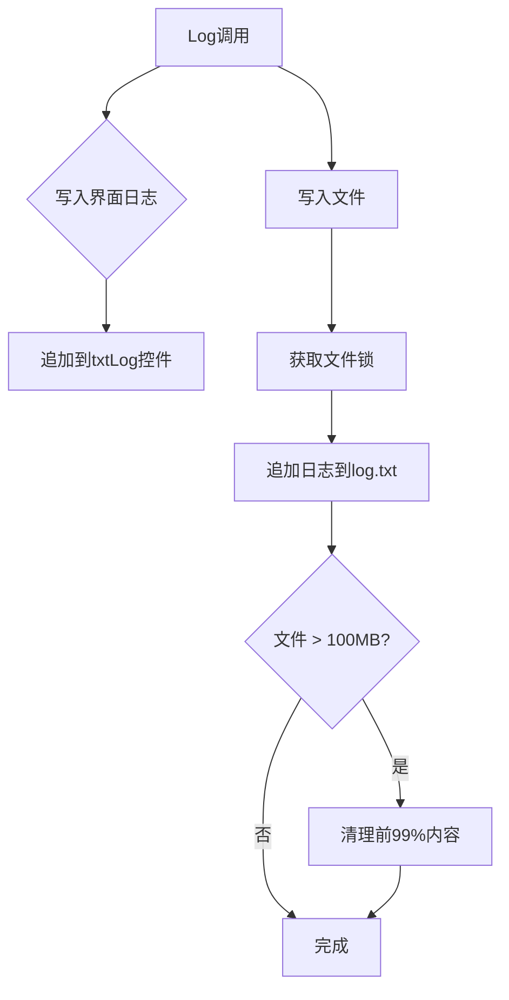

# 日志存储功能说明

## 📅 修改日期
2026-10-14

---

## ✨ 新增功能

### 1. 日志文件存储
所有日志信息自动写入 `log.txt` 文件：

- **文件位置**: 程序根目录/log.txt
- **内容**: 所有日志信息和MessageBox显示的内容
- **格式**: `2026-10-14 10:30:00 日志内容`

### 2. 自动日志清理
当 log.txt 文件超过 **100MB** 时，自动删除前 **99%** 的内容，保留最新 1%：

```
========== 日志清理 2026-10-14 10:30:00 已删除前99%的旧日志 ==========
```

---

## 🔧 技术实现

### 日志写入流程



### 核心方法

#### 1. InitLogFile - 初始化日志文件
```csharp
private void InitLogFile()
{
    // 检查日志文件大小
    if (File.Exists(_logFilePath))
    {
        var fileInfo = new FileInfo(_logFilePath);
        if (fileInfo.Length > MaxLogFileSize) // 100MB
        {
            CleanLogFile();
        }
    }
    else
    {
        File.WriteAllText(_logFilePath, "========== 应用启动 ... ==========\r\n");
    }
}
```

#### 2. CleanLogFile - 清理日志文件
```csharp
private void CleanLogFile()
{
    // 读取所有日志行
    var allLines = File.ReadAllLines(_logFilePath);
    int totalLines = allLines.Length;
    
    // 保留最后 1% 的内容
    int keepLines = Math.Max(totalLines / 100, 100); // 至少保留100行
    var linesToKeep = allLines.Skip(totalLines - keepLines).ToArray();
    
    // 写回文件并添加清理标记
    File.WriteAllLines(_logFilePath, linesToKeep);
    File.AppendAllText(_logFilePath, "========== 日志清理 ... ==========\r\n");
}
```

#### 3. Log - 日志输出（改进版）
```csharp
private void Log(string msg, bool writeToFile = true)
{
    // 显示在界面
    txtLog.AppendText($"{DateTime.Now:HH:mm:ss} {msg}\r\n");
    
    // 写入文件
    if (writeToFile)
    {
        WriteLogToFile($"{DateTime.Now:yyyy-MM-dd HH:mm:ss} {msg}");
    }
}
```

#### 4. ShowMessage - 消息框（替代MessageBox.Show）
```csharp
private void ShowMessage(string message, string title = "提示", ...)
{
    // 先写入日志
    Log($"[消息框-{title}] {message}");
    
    // 再显示MessageBox
    MessageBox.Show(this, message, title, buttons, icon);
}
```

---

## 📝 使用方法

### 普通日志记录
```csharp
Log("正在下载文件...");
// log.txt: 2026-10-14 10:30:00 正在下载文件...
```

### 显示消息框并记录日志
```csharp
ShowMessage("更新完成！");
// log.txt: 2026-10-14 10:30:05 [消息框-提示] 更新完成！
```

### 显示错误消息
```csharp
ShowMessage("连接服务器失败", "错误", MessageBoxButtons.OK, MessageBoxIcon.Error);
// log.txt: 2026-10-14 10:30:10 [消息框-错误] 连接服务器失败
```

---

## 📊 日志文件示例

```
========== 应用启动 2026-10-14 10:00:00 ==========
2026-10-14 10:00:05 正在检测更新...
2026-10-14 10:00:06 [消息框-错误] 连接更新服务器失败：网络不可达
2026-10-14 10:00:10 正在检测更新...
2026-10-14 10:00:11 总下载大小：500 MB
2026-10-14 10:00:12 正在下载：Game.exe
2026-10-14 10:00:15 下载失败：超时
2026-10-14 10:00:16 重试下载 (1/3)：Game.exe
2026-10-14 10:01:00 完成：Game.exe
2026-10-14 10:01:01 正在下载：Data/resources.assets
2026-10-14 10:05:00 ✅全部更新完成！
2026-10-14 10:05:01 [消息框-提示] 更新完成，可以启动程序！

========== 日志清理 2026-10-14 15:00:00 已删除前99%的旧日志 ==========
```

---

## ⚠️ 注意事项

### 1. 线程安全
- 使用 `_logLock` 对象锁确保多线程写入安全
- 防止并发写入导致文件损坏

### 2. 性能优化
- 每次写入后检查文件大小
- 如果超过 100MB 立即清理
- 保留至少 100 行日志

### 3. 文件清理规则
```
原始文件大小: 150 MB
总行数: 500,000 行

清理后:
保留行数: 500,000 / 100 = 5,000 行
文件大小: 约 1.5 MB (保留 1%)
```

---

## 🗑️ 移除的功能

### 剩余时间显示
根据要求，已移除剩余时间相关功能：

| 移除内容 | 说明 |
|----------|------|
| labelTime 控件 | 界面上的剩余时间显示 |
| label4 控件 | "剩余时间："标签 |
| SpeedInfo.RemainingTime | 剩余时间计算 |
| FormatTime 方法 | 时间格式化函数 |

**保留功能**:
- ✅ 下载速度显示
- ✅ 进度百分比
- ✅ 已下载/总大小

---

## 📂 修改的文件

| 文件 | 修改内容 |
|------|----------|
| `Updater\Form1.cs` | 添加日志存储、替换MessageBox为ShowMessage、移除剩余时间 |
| `Updater\Form1.Designer.cs` | 隐藏剩余时间相关控件 |

---

## 🎯 最终效果

### 界面显示
```
┌─────────────────────────────────────────────────────┐
│  [====================        ] 75%                │
│                                                     │
│  75% (750 MB/1 GB)                                 │
│                                                     │
│  下载速度：5.2 MB/s                                │
│                                                     │
│  日志：                                             │
│  10:30:00 总下载大小：1 GB                         │
│  10:30:05 正在下载：Game.exe                       │
│  ...                                               │
└─────────────────────────────────────────────────────┘
```

### log.txt 文件
```
2026-10-14 10:30:00 总下载大小：1 GB
2026-10-14 10:30:05 正在下载：Game.exe
2026-10-14 10:30:35 完成：Game.exe
2026-10-14 10:30:36 [消息框-提示] 更新完成，可以启动程序！
```

---

**文档版本**: 1.0  
**创建日期**: 2026-10-14