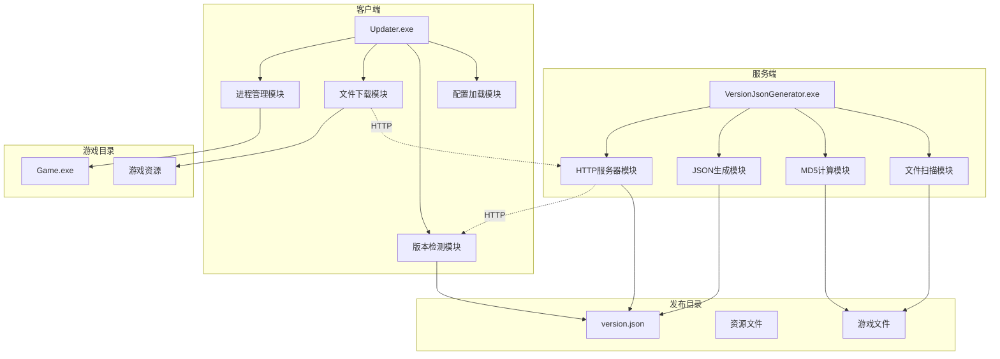
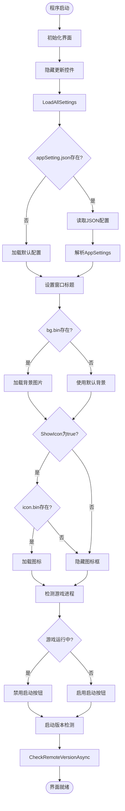
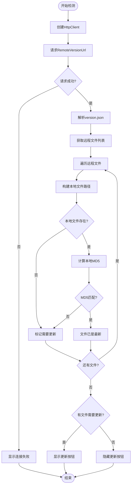
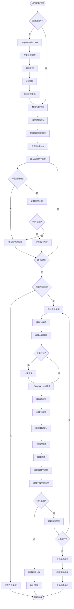
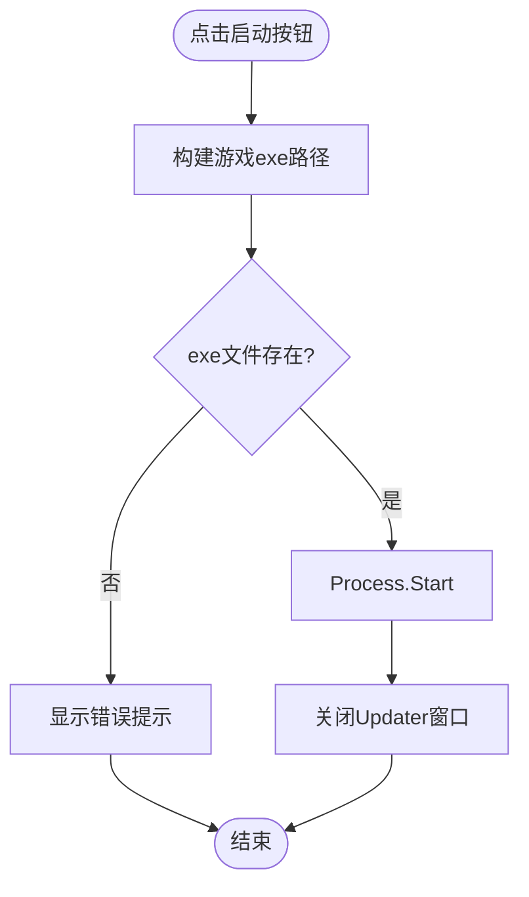
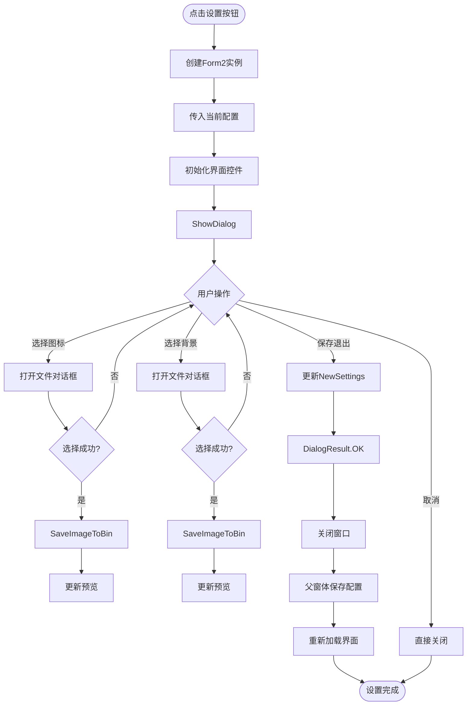
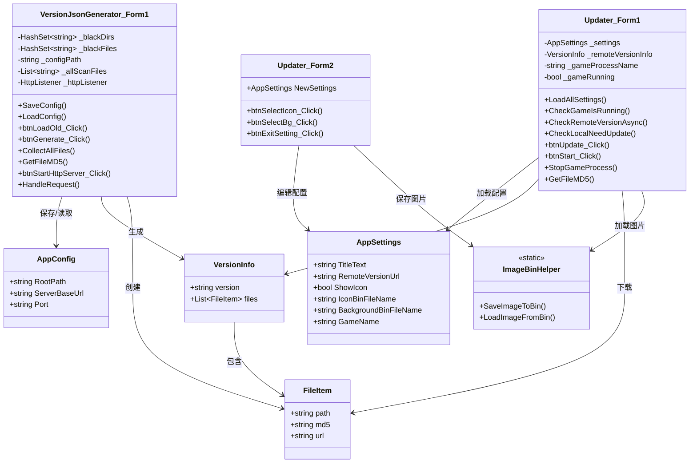
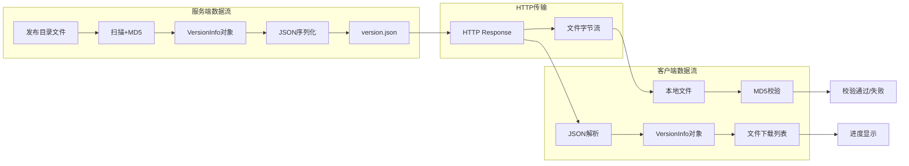
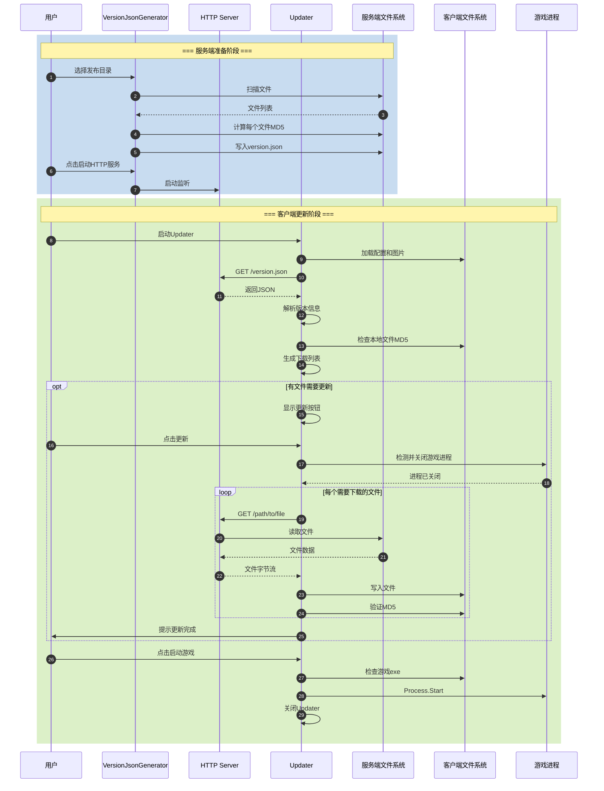
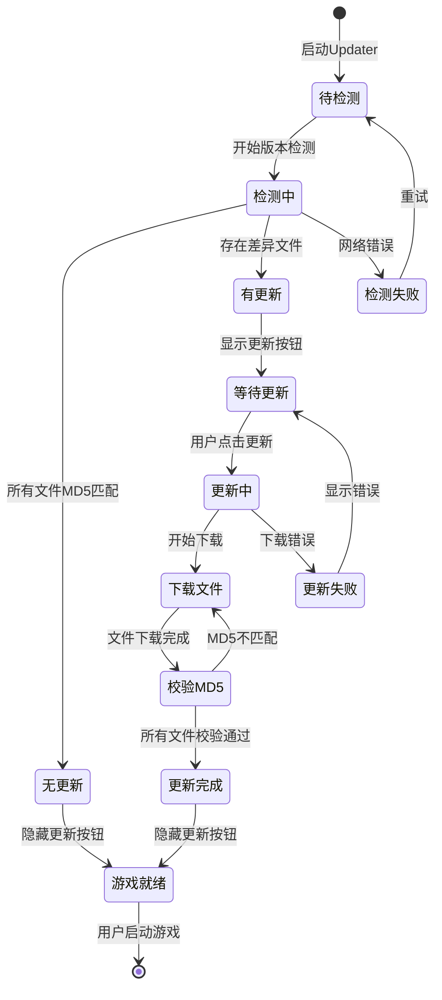

# VersionJsonGenerator 流程图文档

## 1. 系统总体架构图



---

## 2. 服务端版本生成流程

```mermaid
flowchart TD
    Start([开始]) --> A[打开VersionJsonGenerator]
    A --> B[选择发布根目录]
    B --> C{目录存在?}
    
    C -->|否| D[提示错误]
    D --> B
    
    C -->|是| E[设置服务器基础地址]
    E --> F[设置端口号]
    F --> G[点击"读取"按钮]
    
    G --> H{version.json存在?}
    H -->|是| I[读取旧版本号]
    H -->|否| J[设置为0.0.0]
    
    I --> K[自动递增版本号]
    J --> K
    
    K --> L[点击"版本生成"按钮]
    L --> M[清空文件列表]
    M --> N[递归扫描目录]
    
    N --> O{遍历每个文件}
    O --> P{在黑名单中?}
    
    P -->|是| O
    P -->|否| Q[添加到扫描列表]
    Q --> O
    
    O -->|扫描完成| R[遍历扫描列表]
    R --> S[计算文件MD5]
    S --> T[构建FileItem对象]
    T --> U{还有文件?}
    
    U -->|是| R
    U -->|否| V[序列化为JSON]
    V --> W[写入version.json]
    W --> X[显示完成提示]
    
    X --> End([生成完成])
```

---

## 3. HTTP服务启动流程

```mermaid
flowchart TD
    Start([开始]) --> A[点击"启动Http服务"按钮]
    A --> B{发布目录存在?}
    
    B -->|否| C[提示选择目录]
    C --> End([结束])
    
    B -->|是| D{端口格式正确?}
    D -->|否| E[提示端口错误]
    E --> End
    
    D -->|是| F{服务已运行?}
    F -->|是| G[提示已运行]
    G --> End
    
    F -->|否| H[创建HttpListener]
    H --> I[添加URL前缀]
    I --> J[启动监听]
    J --> K[获取本机IP]
    K --> L[更新服务器地址显示]
    L --> M[启动后台任务]
    
    M --> N[等待请求]
    N --> O{收到请求}
    
    O --> P[解析请求路径]
    P --> Q{文件存在?}
    
    Q -->|否| R[返回404]
    R --> N
    
    Q -->|是| S[读取文件内容]
    S --> T[返回文件数据]
    T --> N
    
    N -.可被停止.-> U[点击"停止Http服务"]
    U --> V[停止监听]
    V --> W[关闭连接]
    W --> End
```

---

## 4. 客户端启动流程



---

## 5. 版本检测流程



---

## 6. 文件更新流程



---

## 7. 游戏启动流程



---

## 8. 设置界面流程



---

## 9. 核心类关系图



---

## 10. 数据流转图



---

## 11. 时序图：完整更新流程



---

## 12. 状态转换图



---

**文档版本**: 1.0  
**创建日期**: 2026-10-14